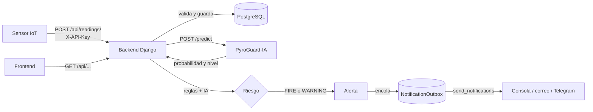

# PyroGuard Backend

API Django REST Framework para recibir lecturas IoT, clasificarlas con reglas,
mantener alertas persistentes y exponer el estado de nodos para el dashboard.
El riesgo se evalúa con reglas deterministas y, si `AI_SERVICE_URL` está
configurada, con la probabilidad del servicio PyroGuard-IA, que solo puede
elevar el nivel. Si la IA no responde, la lectura se guarda y se evalúa solo
con reglas.

## Arquitectura

PyroGuard son tres repositorios: **este backend** (Django), **PyroGuard-IA** (servicio de inferencia) y
**PyroGuard-Frontend** (dashboard). El flujo de una lectura es:



1. **Sensor → backend.** El nodo envía `POST /api/readings/` con `X-API-Key`. Se valida, se descartan las
   lecturas duplicadas (filtro de Bloom + base) y se guarda; se actualiza la última comunicación del nodo.
2. **Backend → IA.** Se consulta a PyroGuard-IA fuera de cualquier transacción (con `AI_ASYNC_EVALUATION=True`
   se deja pendiente y la atiende `drain_ai_queue`). Si la IA no responde, la lectura se guarda igual y se
   evalúa solo con reglas.
3. **Riesgo.** `services/risk_rules.py` combina las reglas con la probabilidad de la IA, que solo puede
   elevar el nivel (`NORMAL` < `WARNING` < `FIRE`).
4. **Alertas.** `services/alerts.py` crea o actualiza una alerta por nodo y nivel. Una alerta `FIRE` nueva
   encola un aviso y se avisa a los nodos vecinos hasta `NEIGHBOR_WARNING_HOPS` saltos.
5. **Avisos.** `send_notifications` envía la cola por prioridad a los canales activos.
6. **Consulta.** El frontend lee nodos, estado, series, alertas y resumen; muchas respuestas salen de
   estructuras en memoria (ver «Estado en memoria»).

Módulos principales:

- `api/models.py`: nodos, lecturas, evaluaciones, alertas, vecinos (`NodeLink`), agregados por hora
  (`ReadingHourly`) y cola de avisos (`NotificationOutbox`).
- `api/services/`: reglas de riesgo, ingesta, IA, alertas, estado de nodos, series, zonas y cachés en memoria.
- `api/structures/`: estructuras de datos propias (ver `docs/ESTRUCTURAS_DE_DATOS.md`).
- `api/notifications/`: canales de aviso y cola de prioridad.
- `api/management/commands/`: `purge_readings`, `aggregate_readings`, `drain_ai_queue`,
  `send_notifications` y `check_offline_nodes`.
- `api/serializers.py`, `api/views.py`, `api/urls.py` y `api/openapi.py`: contratos, endpoints y esquema OpenAPI.
- `api/middleware.py` y `api/logging_utils.py`: `request_id` y logs en JSON.
- `config/settings.py`: configuración por variables de entorno, DRF, CORS, WhiteNoise y base de datos.
- `simulador_iot.py`: productor de lecturas con escenarios controlados.

**Tareas programadas** (no corren solas; por ejemplo, Cron Jobs de Render): `send_notifications` (cada minuto),
`drain_ai_queue` (cada minuto, solo con evaluación diferida), `check_offline_nodes` (cada 5 minutos),
`aggregate_readings` (cada hora) y `purge_readings` (a diario, después de agregar).

La documentación interactiva de la API está en `/api/docs/` y el esquema OpenAPI en `/api/schema/`.

## Requisitos

- Python 3.13 o compatible con Django 6.1.
- SQLite para desarrollo; PostgreSQL recomendado para despliegue.
- Dependencias fijadas en `requirements.txt`.

## Ejecución local

En PowerShell, desde la raíz del backend:

```powershell
python -m venv .venv
\.venv\Scripts\Activate.ps1
python -m pip install -r requirements.txt
Copy-Item .env.example .env
```

Edita `.env` para desarrollo local. `DEBUG=True` y `DATABASE_URL=` seleccionan
SQLite. Aplica las migraciones y crea un usuario administrador:

```powershell
python manage.py migrate
python manage.py createsuperuser
python manage.py runserver
```

El panel de administración queda en `http://localhost:8000/admin/`.

## Seguridad en producción

Con `DEBUG=False` se activan automáticamente (`config/security.py`):

| Ajuste | Valor | Para qué |
| --- | --- | --- |
| `SECURE_SSL_REDIRECT` | `True` | Redirige HTTP a HTTPS (excepto `/api/health/`, que usan los chequeos de la plataforma) |
| `SECURE_PROXY_SSL_HEADER` | `X-Forwarded-Proto: https` | Render termina el HTTPS en su proxy; sin confiar en esta cabecera la redirección haría un bucle |
| `SESSION_COOKIE_SECURE`, `CSRF_COOKIE_SECURE` | `True` | Las cookies solo viajan por HTTPS |
| `SECURE_HSTS_SECONDS` | 30 días | El navegador exige HTTPS en ese dominio |
| Cookies | `HttpOnly` (sesión) y `SameSite=Lax` | Menos exposición ante scripts y CSRF |
| `X-Frame-Options`, `X-Content-Type-Options`, `Referrer-Policy` | `DENY`, `nosniff`, `same-origin` | Cabeceras contra clickjacking y sniffing |

Cada ajuste se puede sobrescribir con una variable de entorno del mismo nombre (ver `.env.example`).
`SECURE_HSTS_SECONDS` empieza en un mes para poder deshacerlo si algo falla; cuando todo funcione por HTTPS
súbelo (p. ej. `31536000`). `SECURE_HSTS_INCLUDE_SUBDOMAINS` y `SECURE_HSTS_PRELOAD` quedan apagados: solo
actívalos si **todos** los subdominios deben servirse por HTTPS. Para revisarlo:
`python manage.py check --deploy` (con `DEBUG=False`; solo deben quedar esas dos advertencias).

## Medición de las estructuras

`python manage.py benchmark_structures` compara cada estructura de `api/structures/` con la consulta equivalente en
la base de datos (por ejemplo, el buffer circular frente a `ORDER BY timestamp DESC LIMIT 50`). Antes de medir comprueba
que estructura y base dan **el mismo resultado**, y todo ocurre dentro de una transacción que se deshace: no deja datos.

```powershell
python manage.py benchmark_structures                              # 1000 y 10000 lecturas
python manage.py benchmark_structures --sizes 1000,10000,50000 --markdown
```

Los resultados y su análisis están en `docs/BENCHMARKS.md`.

## Docker

Con Docker y Docker Compose se levanta todo sin instalar Python ni PostgreSQL: el backend, PyroGuard-IA y
una base PostgreSQL.

```bash
# El repositorio de la IA debe estar junto a este: ../PyroGuard - IA (o indica otra ruta con IA_CONTEXT)
docker compose up --build
```

| Servicio | Dirección | Notas |
| --- | --- | --- |
| Backend | `http://localhost:8000` | API en `/api/`, documentación en `/api/docs/`, admin en `/admin/` |
| IA | `http://localhost:8001` | Se comunica con el backend por la red de Compose (`AI_SERVICE_URL=http://ia:8001`) |
| PostgreSQL | solo dentro de Compose | Datos en el volumen `pgdata` |

Al arrancar, el backend aplica las migraciones y recopila los estáticos (igual que el `Procfile`). Con las claves
de desarrollo que trae `docker-compose.yml` (cámbialas con variables de entorno o un `.env` propio:
`SECRET_KEY`, `INGEST_API_KEY`, `AI_API_KEY`) y `AUTO_REGISTER_NODES=True`, ya se puede enviar datos:

```bash
docker compose exec backend python manage.py createsuperuser            # acceso al admin
docker compose exec backend python manage.py seed_demo                  # datos de ejemplo
python simulador_iot.py --nodes 3 --api-key clave-ingesta-local         # desde tu máquina
docker compose exec backend python manage.py test                       # pruebas dentro del contenedor
docker compose down            # detiene (conserva los datos); con -v también borra la base
```

La imagen (`Dockerfile`) usa `python:3.13-slim`, instala solo `requirements.txt`, no corre como root y
excluye secretos y bases locales (`.dockerignore`). Los comandos programados (`send_notifications`,
`check_offline_nodes`...) se pueden lanzar con `docker compose exec backend python manage.py <comando>`.
`docker-compose.yml` es solo para desarrollo local, no para producción.

## Variables de entorno

| Variable | Uso | Valor local de ejemplo |
| --- | --- | --- |
| `SECRET_KEY` | Secreto Django; obligatorio con `DEBUG=False` | Vacío en desarrollo, Django genera uno temporal |
| `DEBUG` | Activa modo de desarrollo | `True` |
| `DATABASE_URL` | URL PostgreSQL; vacía usa SQLite | Vacía |
| `INGEST_API_KEY` | Clave del header `X-API-Key` para ingesta | Definir una clave local propia |
| `NODE_OFFLINE_THRESHOLD_SECONDS` | Segundos sin comunicación para marcar OFFLINE | `300` |
| `ALERT_ON_WARNING` | Habilita alertas WARNING | `False` |
| `AUTO_REGISTER_NODES` | Crea nodos desconocidos durante la ingesta | `False` |
| `RECENT_READINGS_PER_NODE` | Lecturas recientes que cada nodo guarda en memoria (entero ≥ 1) | `50` |
| `NODE_STATUS_CACHE_SIZE` | Nodos cuyo `/status/` se guarda en la caché LRU en memoria (entero ≥ 0; 0 la desactiva) | `256` |
| `NOTIFICATION_CHANNELS` | Canales de aviso activos, separados por comas: `console`, `email`, `telegram` | `console` |
| `NOTIFICATION_COOLDOWN_SECONDS` | Segundos sin repetir el mismo aviso del mismo nodo (entero ≥ 0; 0 lo desactiva) | `300` |
| `NOTIFICATION_MAX_ATTEMPTS` | Intentos de envío de un aviso antes de darlo por fallido (entero ≥ 1) | `3` |
| `NOTIFY_EMAIL_TO` | Destinatarios del correo, separados por comas | Vacío |
| `EMAIL_HOST`, `EMAIL_PORT`, `EMAIL_HOST_USER`, `EMAIL_HOST_PASSWORD`, `EMAIL_USE_TLS`, `DEFAULT_FROM_EMAIL` | Servidor SMTP y remitente del canal de correo | Vacíos (`587`, `True`) |
| `TELEGRAM_BOT_TOKEN`, `TELEGRAM_CHAT_ID` | Token del bot (BotFather) y chat de destino del canal de Telegram | Vacíos |
| `READINGS_RETENTION_DAYS` | Días que se conservan las lecturas antes de que `purge_readings` las borre (entero ≥ 1) | `90` |
| `NEIGHBOR_WARNING_HOPS` | Saltos hacia los vecinos a los que se avisa cuando un nodo entra en `FIRE` (entero ≥ 0; 0 lo desactiva) | `2` |
| `DEDUPLICATE_READINGS` | Descarta las lecturas repetidas (mismo nodo y `timestamp`) | `True` |
| `DUPLICATE_FILTER_CAPACITY` | Lecturas que recuerda el filtro de Bloom antes de reconstruirse (entero ≥ 1) | `100000` |
| `DASHBOARD_CACHE_SECONDS` | Segundos que se reutiliza el resumen de `/dashboard/summary/` (número ≥ 0; 0 lo desactiva) | `5` |
| `TEMPERATURE_WINDOW_SIZE` | Lecturas que cubre la ventana de temperatura máxima y mínima de cada nodo (entero ≥ 1) | `20` |
| `AI_SERVICE_URL` | URL base de PyroGuard-IA; vacía deshabilita la IA | `http://127.0.0.1:8001` |
| `AI_CONNECT_TIMEOUT` | Segundos máximos para conectar con la IA (> 0) | `3.0` |
| `AI_READ_TIMEOUT` | Segundos máximos de espera de la inferencia (> 0) | `10.0` |
| `AI_ASYNC_EVALUATION` | Si es `True`, la ingesta no espera a la IA: deja la evaluación pendiente para `drain_ai_queue` (ver «Evaluación diferida de la IA») | `False` |
| `AI_API_KEY` | Clave enviada en `X-AI-API-Key`; igual a la del servicio IA | Vacía en local |
| `LOG_LEVEL` | Nivel de logging | `INFO` |
| `LOG_FORMAT` | Formato de los logs: `text` o `json` (una línea JSON por registro, con `request_id`) | `text` |
| `PUBLIC_READ_ACCESS` | Si es `False`, las consultas GET también exigen token | `True` |
| `THROTTLE_READ_RATE` | Límite de consultas GET por IP (`N/sec`, `N/min`, `N/hour` o `N/day`) | `120/min` |
| `THROTTLE_INGEST_RATE` | Límite de ingesta POST de lecturas por IP, con el mismo formato | `300/min` |
| `THROTTLE_LOGIN_RATE` | Límite de intentos de `POST /auth/login/` por IP, con el mismo formato | `10/min` |
| `CLIENT_IP_HEADER` | Cabecera con la IP del cliente que escribe un proxy de confianza (en Render, `CF-Connecting-IP`) | Vacío |
| `NUM_PROXIES` | Saltos de proxy delante de la app, si no se usa `CLIENT_IP_HEADER` | Vacío |
| `EXTRA_ALLOWED_HOSTS` | Hosts adicionales separados por comas | Vacío |
| `EXTRA_CORS_ORIGINS` | Orígenes CORS adicionales separados por comas | Vacío |

No publiques `.env`, claves API, tokens ni `SECRET_KEY`. `.env` está excluido
por `.gitignore`; `.env.example` contiene nombres de variables y placeholders.

## Endpoints

La base común es `http://localhost:8000/api`. Las consultas GET son públicas por
defecto (ver «Acceso de lectura»). Las escrituras de nodos y transiciones de
alertas requieren autenticación DRF.
La ingesta POST requiere `X-API-Key`, incluso si el cliente también tiene sesión
o token; con `DEBUG=True` y `INGEST_API_KEY` vacía se permite para desarrollo y
se registra una advertencia.

| Método y ruta | Descripción |
| --- | --- |
| `GET /health/` | Estado de la base de datos y de la IA: `ok`, `degraded` (IA caída, 200) o `down` (base caída, 503). Público y sin límite de peticiones |
| `POST /readings/` | Ingresa una lectura (requiere `X-API-Key`), persiste riesgo y puede crear/actualizar alerta. Si ya existe una lectura del mismo nodo y `timestamp` responde `200` con `status: "duplicate"` y no guarda nada (ver «Lecturas duplicadas») |
| `GET /readings/` | Lista plana; filtros `node_id`, `from`, `to`, `range`, `limit`, `offset`, `order` |
| `GET /readings/series/` | Serie histórica de un campo para uno o varios nodos, con promedios por tramos (`step`) y mezcla (`merge`) (ver «Series históricas») |
| `GET /nodes/`, `POST /nodes/` | Listar nodos / crear nodo (autenticado) |
| `GET`, `PUT`, `PATCH`, `DELETE /nodes/{node_id}/` | CRUD de un nodo; `node_id` no cambia |
| `GET /nodes/search/?prefix=` | Identificadores que empiezan por `prefix`, sin distinguir mayúsculas; `limit` de 1 a 100 (20 por defecto) |
| `GET /nodes/{node_id}/status/` | Conexión, última lectura, riesgo actual, ventana de temperatura (`temperature_window`) y alertas activas |
| `GET /nodes/{node_id}/readings/` | Lecturas del nodo con los mismos filtros de `/readings/` |
| `GET /nodes/{node_id}/recent/` | Últimas lecturas del nodo (la más nueva primero) servidas desde memoria; `limit` hasta `RECENT_READINGS_PER_NODE` |
| `GET /nodes/{node_id}/links/`, `POST /nodes/{node_id}/links/` | Listar los vecinos directos / registrar uno con `{"neighbor": "node_id"}` (autenticado; `409` si ya lo eran) |
| `DELETE /nodes/{node_id}/links/{neighbor_id}/` | Quitar el vínculo entre dos nodos (autenticado) |
| `GET /nodes/{node_id}/neighbors/?hops=` | Nodos alcanzables en `hops` saltos o menos (1 a 10, 1 por defecto) con la distancia de cada uno |
| `GET /dashboard/summary/` | Conteos, riesgo global y última lectura por nodo (se reutiliza `DASHBOARD_CACHE_SECONDS`) |
| `GET /dashboard/top-risk/?k=` | Los `k` nodos de mayor riesgo actual (1 a 50, 5 por defecto) |
| `GET /dashboard/zones/` | Zonas de riesgo: grupos de nodos vecinos conectados en `WARNING` o `FIRE` a la vez (solo nodos online) |
| `GET /alerts/` | Historial de alertas; filtros `status`, `level`, `node_id`, `from`, `to`, `limit` (100 por defecto) y `offset` |
| `GET /alerts/active/` | Alertas activas por urgencia: `FIRE` antes que `WARNING` y, a igual nivel, la más antigua primero |
| `GET /alerts/{id}/` | Detalle de una alerta |
| `POST /alerts/{id}/acknowledge/`, `POST /alerts/{id}/close/` | Cambiar el estado de una alerta (autenticado; `409` si la transición no es válida) |
| `POST /auth/login/` | Obtener token de DRF (con límite de intentos) |
| `GET /schema/`, `GET /docs/` | Esquema OpenAPI (YAML o `?format=json`) e interfaz Swagger |

Todas las respuestas llevan `X-Request-ID`; las listas paginadas devuelven `X-Total-Count`.

Autenticación de ingesta:

```bash
curl -X POST http://localhost:8000/api/readings/ \
	-H "Content-Type: application/json" \
	-H "X-API-Key: $INGEST_API_KEY" \
	-d '{"node_id":"SIM-001","temperature":24.5,"humidity":48,"smoke":18,"gas":3.2,"flame":false,"timestamp":"2026-10-17T15:30:00Z"}'
```

Token para operaciones autenticadas:

```bash
curl -X POST http://localhost:8000/api/auth/login/ \
	-H "Content-Type: application/json" \
	-d '{"username":"USUARIO","password":"CONTRASENA"}'

curl -H "Authorization: Token TOKEN_RECIBIDO" \
	http://localhost:8000/api/nodes/
```

Ejemplo de status y filtros de lectura:

```bash
curl http://localhost:8000/api/nodes/SIM-001/status/
curl "http://localhost:8000/api/readings/?node_id=SIM-001&range=24h&limit=50&order=desc"
curl http://localhost:8000/api/dashboard/summary/
```

## Series históricas

`GET /readings/series/` alimenta el gráfico histórico. Parámetros:

| Parámetro | Descripción |
| --- | --- |
| `node_id` | Obligatorio; hasta 10 nodos, repetido o separado por comas |
| `field` | `temperature` (por defecto), `humidity`, `smoke` o `gas` |
| `from`, `to` | ISO 8601; por defecto las últimas 24 h; el intervalo no puede superar 31 días |
| `step` | Segundos por tramo (1 a 86400). Devuelve el promedio de cada tramo en lugar de los puntos |
| `merge` | `true` añade `merged`: todos los nodos en una sola línea de tiempo |

```bash
curl "http://localhost:8000/api/readings/series/?node_id=SIM-001,SIM-002&field=temperature&step=300&merge=true"
```

Respuesta (resumida):

```json
{
  "field": "temperature", "from": "...", "to": "...", "step": 300,
  "series": [
    {"node_id": "SIM-001", "count": 12, "average": 24.1,
     "buckets": [{"start": "2026-10-30T12:00:00Z", "count": 4, "average": 23.8}]}
  ],
  "merged": [{"node_id": "SIM-001", "start": "2026-10-30T12:00:00Z", "count": 4, "average": 23.8}]
}
```

Sin `step`, cada serie trae `points` (`{timestamp, value}`) y `merged` trae `{node_id, timestamp, value}`.
Los tramos se alinean al reloj (UTC) y solo aparecen los que tienen datos. Las lecturas sin el
campo pedido (por ejemplo, sin `gas`) se omiten. Sin `step` se devuelven como máximo 5000 puntos por
nodo (`400` si hay más: acorta el intervalo o usa `step`); con `step` el tope es de 200 000 lecturas.

Cómo se calcula: la base entrega las lecturas ordenadas; **la búsqueda binaria** localiza en O(log n)
dónde empieza y termina cada intervalo o tramo, **las sumas de prefijos** dan su promedio en O(1) (resumir
en `b` tramos cuesta O(n + b log n) y no O(n · b)) y **la mezcla de k listas ordenadas con un montículo**
junta los nodos en O(N log k) sin reordenar todo.

## Retención de lecturas

Las lecturas crecen sin parar, así que el comando `purge_readings` borra las anteriores a
`READINGS_RETENTION_DAYS` (90 por defecto). Sus evaluaciones de riesgo se borran con ellas,
pero **las lecturas que originaron una alerta se conservan** para no perder el historial.

```bash
python manage.py purge_readings --dry-run      # solo cuenta lo que borraría
python manage.py purge_readings                # borra con la retención configurada
python manage.py purge_readings --days 30      # retención puntual
python manage.py purge_readings --batch-size 500
```

Borra por lotes (`--batch-size`, 1000 por defecto) para no bloquear la base. Conviene
programarlo a diario (por ejemplo, un Cron Job de Render); el comando no se ejecuta solo.

## Notificaciones

Cuando algo grave ocurre se **encola un aviso** en la base (`NotificationOutbox`) y otro proceso lo
envía; así un canal lento o caído no retrasa la ingesta y se puede reintentar.

| Aviso | Cuándo se encola | Prioridad |
| --- | --- | --- |
| `FIRE_ALERT` | Se crea una alerta `FIRE` nueva (actualizar una existente no avisa otra vez) | 1 (más urgente) |
| `OFFLINE_ALERT` | `check_offline_nodes` encuentra un nodo desconectado con una alerta activa | 2 |

Canales (`NOTIFICATION_CHANNELS`, se pueden combinar): `console` (log `api.notifications`),
`email` (necesita `NOTIFY_EMAIL_TO` y el SMTP `EMAIL_*`) y `telegram` (necesita `TELEGRAM_BOT_TOKEN` y
`TELEGRAM_CHAT_ID`). Un canal activado sin configuración se omite con un aviso en el log. Para
Telegram, crea el bot con @BotFather y obtén el `chat_id` escribiéndole al bot y consultando
`https://api.telegram.org/bot<TOKEN>/getUpdates`. No publiques el token.

Comandos (hay que programarlos; no corren solos, por ejemplo con Cron Jobs de Render):

```bash
python manage.py send_notifications --limit 100   # envía los pendientes, el más urgente primero (cada minuto)
python manage.py check_offline_nodes              # lista los nodos desconectados y avisa si tienen alerta activa (cada 5 min)
python manage.py check_offline_nodes --no-notify  # solo lista
```

- **Orden:** se envían con un montículo mínimo por prioridad y, a igual prioridad, por antigüedad.
- **Reintentos:** un aviso queda `SENT` cuando lo recibieron todos los canales activos. Si uno falla se
  reintenta en la siguiente ejecución **solo por los canales que faltan**, y tras
  `NOTIFICATION_MAX_ATTEMPTS` intentos pasa a `FAILED` (el motivo queda en `last_error`, visible en el admin).
- **Ventana de silencio:** no se repite el mismo tipo de aviso del mismo nodo durante
  `NOTIFICATION_COOLDOWN_SECONDS`, aunque el anterior ya se haya enviado; evita avisos en cascada
  cuando un nodo oscila entre estados.
- **Seguridad:** los errores de los canales no incluyen el token ni los detalles del servidor.

## Evaluación diferida de la IA

Por defecto la ingesta pide la predicción a PyroGuard-IA antes de responder, así que si la IA
va lenta o está caída el sensor espera hasta `AI_CONNECT_TIMEOUT + AI_READ_TIMEOUT` (13 s con los
valores por defecto) por cada lectura; `api/test_ingestion_latency.py` lo mide.

Con `AI_ASYNC_EVALUATION=True` (y `AI_SERVICE_URL` definida) la ingesta responde enseguida: guarda
la lectura con el riesgo de las reglas y deja su evaluación en estado `PENDING` (`ai.status` en la
respuesta). Un proceso aparte las atiende por orden de llegada:

```bash
python manage.py drain_ai_queue --limit 500
```

Cada evaluación pendiente se completa con la IA, se recalcula el riesgo (que puede subir a `WARNING` o
`FIRE` y crear la alerta o avisar a los vecinos). Si la IA no responde, el comando se detiene en la
primera (no espera un timeout por cada pendiente) y deja el resto para la próxima ejecución. Hay que
programarlo con una frecuencia corta (por ejemplo, cada minuto en un Cron Job de Render). Mientras una
lectura está pendiente, `/recent/` conserva el riesgo que tenía al ingresar hasta que el worker recargue.

## Agregados por hora

`python manage.py aggregate_readings` guarda en `ReadingHourly` el resumen por nodo y hora
(cantidad, temperatura mínima/media/máxima, humedad media, humo máximo y lecturas con llama).
Es idempotente: recalcula desde la última hora ya resumida, de modo que se puede programar
cada hora. Los resúmenes **no se borran con `purge_readings`**, así que conviene agregar
antes de purgar. `--all` recalcula todo, pero no lo uses después de purgar porque
sobrescribiría con datos incompletos.

## Lecturas duplicadas

Un sensor que reintenta un envío repite la lectura. Dos lecturas con el mismo nodo y
el mismo instante (`timestamp`, sin importar la zona horaria) se consideran la misma:
la segunda no se guarda ni genera alertas y la API responde `200` con
`"status": "duplicate"` y la lectura que ya existía.

Para no consultar la base en cada ingesta se usa un filtro de Bloom en memoria: si dice
que la lectura es nueva se guarda directamente; si dice que quizá ya está, se **confirma
en la base** antes de descartarla (un falso positivo del filtro nunca pierde un dato).
El filtro se rellena con las últimas lecturas la primera vez que se usa y se reconstruye
al superar `DUPLICATE_FILTER_CAPACITY`; cada worker tiene el suyo, así que un duplicado
de una lectura muy antigua o llegado a otro worker puede guardarse repetido. Se
desactiva con `DEDUPLICATE_READINGS=False`.

## Vecinos y propagación del riesgo

Los nodos cercanos se enlazan con `POST /nodes/{id}/links/`. Con esos enlaces se arma un
grafo en memoria (un worker, una copia) que responde `/nodes/{id}/neighbors/?hops=` con
un recorrido en anchura. Cuando una lectura deja un nodo en `FIRE`, la ingesta avisa a
sus vecinos hasta `NEIGHBOR_WARNING_HOPS` saltos: hoy el aviso se registra en el log
(`Nodo X en FIRE: aviso a N nodo(s) vecino(s)...`) y es el punto de enganche de las
notificaciones.

## Logs y trazabilidad

Cada petición recibe un `request_id`: se reutiliza el `X-Request-ID` que mande el cliente o el proxy
(si tiene solo letras, números, `.`, `_` y `-`, hasta 64 caracteres) y si no se genera uno. Aparece en todos
los logs de esa petición, también los de la ingesta y los avisos, y se devuelve en la cabecera de la
respuesta `X-Request-ID` (expuesta por CORS). Con `LOG_FORMAT=json` cada registro es una línea JSON:

```json
{"time": "2026-10-30T12:00:01.532+00:00", "level": "INFO", "logger": "api.readings", "message": "Lectura recibida node_id=SIM-001 risk_level=NORMAL ai_status=OK", "request_id": "3f2a9c1e5b7d4a60a1c2d3e4f5061728"}
```

Fuera de una petición (comandos, tareas programadas) el `request_id` es `-`.

## Estado en memoria

Varias funciones guardan estado en la memoria del proceso para no consultar la base en
cada petición:

| Estado | Módulo | Estructura |
| --- | --- | --- |
| Últimas lecturas y ventana de temperatura por nodo | `services/live_readings.py` | `RecentItemsRing`, `RollingExtremesWindow` |
| Estado de cada nodo (`/status/`) | `services/node_status_cache.py` | `LeastRecentlyUsedCache` |
| Resumen del dashboard | `services/dashboard_cache.py` | `LeastRecentlyUsedCache` |
| Lecturas duplicadas | `services/duplicate_readings.py` | `DuplicateBloomFilter` |
| Búsqueda por prefijo | `services/node_search.py` | `PrefixTrie` |
| Vecinos y zonas | `services/node_graph.py` | `AdjacencyGraph` |

Qué hay que saber:

- **Hilos:** las estructuras no son seguras entre hilos, así que cada servicio las protege
  con un `threading.RLock` (`services/locking.py`) y solo un hilo a la vez las toca.
- **Workers:** cada worker de gunicorn es un proceso distinto y tiene **su propia copia** de
  todo este estado; no se comparte ni se sincroniza. Con varios workers, una caché puede
  seguir mostrando un dato viejo hasta que caduque o se invalide en ese worker, y el
  filtro de duplicados de un worker no conoce lo que vio otro. El `Procfile` arranca
  gunicorn con su valor por defecto (un worker), donde esto no ocurre; si se añaden
  workers o instancias, revisa las funciones anteriores.
- **Reinicios:** todo se pierde al reiniciar el proceso y se reconstruye desde la base la
  primera vez que se usa. La base de datos sigue siendo la única fuente de verdad.
- **Pruebas:** cada estructura tiene sus pruebas en `api/test_structures.py` y cada uso en
  su propio `api/test_*.py`; las pruebas limpian este estado entre casos.

## Acceso de lectura

| Endpoint | Lectura (GET) | Escritura |
| --- | --- | --- |
| `/readings/`, `/dashboard/summary/`, `/nodes/…`, `/alerts/…` | Pública | Nodos y transiciones de alertas: token. Lecturas: `X-API-Key` |
| `/auth/login/` | — | Siempre abierto, para poder obtener el token |

Hoy son públicas porque el dashboard aún no tiene inicio de sesión. Con
`PUBLIC_READ_ACCESS=False` todas las consultas GET responden HTTP 401 sin
`Authorization: Token …`, sin tocar código. La ingesta con `X-API-Key` y el login
no cambian. Las lecturas muestran estado de nodos y alertas, por lo que conviene
cerrarlas en cuanto el frontend pueda enviar el token.

## Límite de peticiones

Cada IP tiene tres cupos independientes: las consultas GET (`THROTTLE_READ_RATE`,
compartido por todos los endpoints de lectura), la ingesta POST de lecturas
(`THROTTLE_INGEST_RATE`, holgado para varios nodos detrás de una misma red) y
los intentos de login (`THROTTLE_LOGIN_RATE`, estricto para frenar la fuerza
bruta de contraseñas). Al superarlos la API responde HTTP 429 con la cabecera
`Retry-After`. Las peticiones sin credenciales válidas se rechazan antes de
contar contra el cupo de ingesta.

Los contadores viven en la memoria de cada proceso, así que con varios workers
de gunicorn el límite efectivo se multiplica por el número de workers.

### IP del cliente detrás de un proxy

Detrás de un proxy la app solo ve la IP del proxy, así que hay que decir de
dónde sacar la IP real. Hay tres opciones, de más a menos recomendable:

1. **`CLIENT_IP_HEADER`** (recomendada en Render): nombre de una cabecera que
   escribe un proxy de confianza y que pisa lo que envíe el cliente. Render
   pone a Cloudflare delante de los servicios web públicos, y Cloudflare escribe
   `CF-Connecting-IP`; con `CLIENT_IP_HEADER=CF-Connecting-IP` el cupo es por
   cliente real. No se mira `X-Forwarded-For`, así que no se puede esquivar el
   límite falseándolo. Si la cabecera falta o no es una IP válida se usa la IP
   del socket. No la uses si la app es alcanzable sin pasar por ese proxy, porque
   entonces cualquiera podría enviar la cabecera.
2. **`NUM_PROXIES`**: número de saltos de proxy delante de la app; se toma la IP
   que corresponde de `X-Forwarded-For`. Exige acertar el número exacto: de menos,
   varios clientes comparten cupo; de más, un cliente puede falsear su IP.
3. **Ninguna de las dos**: se usa todo `X-Forwarded-For`, que el cliente puede
   falsear para esquivar el límite. Solo es aceptable en desarrollo local.

## Contrato de lectura

Los campos obligatorios son `node_id`, `temperature`, `humidity`, `smoke`,
`flame` y `timestamp`. `gas` es opcional y acepta `null`. `flame` acepta
booleano o `0`/`1`. Timestamp debe ser ISO 8601 y no puede superar cinco
minutos en el futuro. Rangos aceptados: temperatura `-50..150`, humedad
`0..100`, humo `>=0` y gas `>=0`.

```json
{
	"node_id": "SIM-001",
	"temperature": 24.5,
	"humidity": 48,
	"smoke": 18,
	"gas": 3.2,
	"flame": false,
	"timestamp": "2026-10-17T15:30:00Z"
}
```

`GET /api/readings/` devuelve siempre una lista JSON plana, incluso sin
resultados (`[]`). `range` acepta `24h` o `7d`; `limit` va de 1 a 500 y por
defecto es 20; `order` acepta `asc` o `desc` y por defecto es `desc`.

Paginación: `offset` (0 por defecto) salta esa cantidad de resultados tras
aplicar filtros y orden. La respuesta sigue siendo una lista plana y la
cabecera `X-Total-Count` trae el total de resultados del filtro, sin contar
`limit` ni `offset`, para que el cliente calcule las páginas. También rigen en
`/nodes/{node_id}/readings/` y en `/alerts/` (donde `limit` vale 100 por
defecto). La cabecera se expone por CORS. Un `limit` fuera de 1–500 o un
`offset` negativo o no numérico devuelven HTTP 400.

```bash
curl -i "http://localhost:8000/api/readings/?node_id=SIM-001&limit=20&offset=40"
```

Cada lectura incluye `risk_level`, la decisión final del backend, y `ai`, el
resultado de PyroGuard-IA usado como evidencia (`null` si la lectura aún no
tiene evaluación):

```json
"ai": {
	"status": "OK",
	"risk_level": "WARNING",
	"probability": 0.6,
	"probabilities": {"NORMAL": 0.4, "WARNING": 0.35, "FIRE": 0.25},
	"model_version": "pyroguard-rf-1.0.0"
}
```

`status` puede ser `OK`, `DISABLED` (sin `AI_SERVICE_URL`), `UNAVAILABLE`
(timeout, conexión o error del servicio), `REJECTED` (credencial o datos
rechazados) o `INVALID_RESPONSE`. Si no es `OK`, el riesgo se calcula solo con
reglas y los demás campos de `ai` son `null` o `{}`. La IA puede elevar el nivel
de riesgo, pero nunca reducir el resultado de las reglas.

## Reglas de riesgo

Los umbrales son valores del prototipo, ajustables por el equipo, definidos en
`api/services/risk_rules.py`:

| Constante | Umbral |
| --- | ---: |
| `SMOKE_WARNING` | 40 |
| `SMOKE_FIRE` | 60 |
| `TEMP_WARNING` | 40 |
| `TEMP_FIRE` | 50 |
| `HUMIDITY_DRY` | 25 |

Son señales: llama activa; humo `>=40`; temperatura `>=40`; humedad `<=25` con
temperatura `>=35`. Son señales fuertes: llama, humo `>=60` y temperatura
`>=50`. `FIRE` requiere dos señales fuertes; una llama aislada queda en
`WARNING`. Una o más señales no fuertes producen `WARNING`; sin señales es
`NORMAL`.

La interfaz para IA recibe `ai_probability` (ahora `None`): `>=0.85` junto con
alguna señal de sensor eleva a `FIRE`; `>=0.5` eleva como mínimo a `WARNING`.
La IA nunca reduce el nivel calculado por sensores. No hay servicio de predicción
implementado todavía.

## Estado y alertas

Un nodo sin comunicación conocida es `UNKNOWN`. Si el último contacto ocurrió
dentro de `NODE_OFFLINE_THRESHOLD_SECONDS`, es `ONLINE`; si excede el umbral, es
`OFFLINE`. Para nodos offline, `/status/` conserva el último riesgo conocido y
marca `current_risk_stale=true`: es historial, no un riesgo actual confirmado.
El resumen global considera solo nodos online.

`/status/` incluye `temperature_window` con la temperatura máxima (`max`) y mínima
(`min`) de las últimas `TEMPERATURE_WINDOW_SIZE` lecturas del nodo (`readings` dice
cuántas contiene de verdad y `size` su capacidad), o `null` si el nodo no tiene
lecturas. Se calcula en O(1) con una ventana en memoria que la primera consulta
carga de la base y la ingesta mantiene al día; se pierde al reiniciar el proceso.

Se crea alerta para `FIRE`; las de `WARNING` dependen de `ALERT_ON_WARNING`.
Una alerta del mismo nodo y nivel en `ACTIVE` o `ACKNOWLEDGED` se actualiza:
incrementa `occurrences` y cambia `last_seen_at`. Un ascenso de WARNING a FIRE
crea una alerta FIRE separada. Cerrar una alerta permite que un evento futuro
genere una nueva. Las alertas no se eliminan al reconocerlas o cerrarlas.

Transiciones válidas: `ACTIVE -> ACKNOWLEDGED -> CLOSED` y `ACTIVE -> CLOSED`.
Las transiciones inválidas devuelven HTTP 409; reconocimiento y cierre registran
sus fechas y requieren autenticación.

## Datos de demostración

`python manage.py seed_demo` crea nodos `SIM-001`, `SIM-002`... enlazados en anillo, con horas de lecturas
de ejemplo para ver el dashboard con vida sin esperar a un sensor ni a la IA:

- `SIM-001` termina en `FIRE` (con su alerta) y `SIM-002`, su vecino, en `WARNING`: forman una **zona de riesgo**.
- El último nodo deja de comunicarse hace 2 horas (`OFFLINE`); el resto está normal.

```powershell
python manage.py seed_demo                          # 6 nodos y 6 horas de historial
python manage.py seed_demo --nodes 10 --hours 24    # nodos: 3 a 50; horas: 3 a 72
python manage.py seed_demo --seed 42                # mismos valores cada vez
python manage.py seed_demo --reset                  # borra antes los nodos SIM-* y los vuelve a crear
```

Sin `--reset` se niega a ejecutarse si ya existen nodos `SIM-*`. Solo toca nodos con ese prefijo.

## Simulador

El simulador usa por defecto `API_URL` o `http://localhost:8000/api/readings/`,
`NODE-001`, cinco segundos y `INGEST_API_KEY`. Para nodos de prueba se recomienda
el prefijo `SIM-`, por ejemplo `SIM-001`.

```powershell
python simulador_iot.py --node SIM-001 --scenario normal
python simulador_iot.py --node SIM-001 --scenario warning --interval 2
python simulador_iot.py --node SIM-001 --scenario fire --api-key $env:INGEST_API_KEY
python simulador_iot.py --url http://localhost:8000/api/readings/ --scenario random
python simulador_iot.py --nodes 5 --scenario random             # SIM-001 ... SIM-005 a la vez
python simulador_iot.py --nodes 3 --prefix BOSQUE- --seed 42    # BOSQUE-001..003, valores repetibles
```

Con `--nodes N` (2 a 100) cada ronda envía una lectura por nodo, con los identificadores
`PREFIJO001`, `PREFIJO002`... (`--prefix`, por defecto `SIM-`); los nodos deben existir o el backend debe
tener `AUTO_REGISTER_NODES=True`. Con `--seed` los escenarios y valores se repiten exactamente
(solo cambia la marca de tiempo), útil para reproducir un caso.

Escenarios `normal`, `warning` y `fire` son reproducibles por categoría; sus
mediciones varían dentro de rangos que corresponden a las reglas. `random`
elige categorías con pesos 85/10/5. El log identifica las lecturas como
`SIMULADO`. El simulador importa umbrales del paquete del backend y debe
ejecutarse desde la raíz del backend.

## Pruebas

Usa SQLite local, sin `DATABASE_URL`, y activa `DEBUG` en PowerShell:

```powershell
$env:DEBUG = "True"
$env:DATABASE_URL = ""
python manage.py check
python manage.py makemigrations --check
python manage.py test
```

El test runner crea y destruye su propia base SQLite temporal. No uses una URL
de una base compartida para estas comprobaciones. Los tests nunca llaman al
servicio de IA real: la red se simula.

`api/contract_examples/` es una copia de `docs/contract/examples/` de
PyroGuard-IA, y ambas suites la usan para verificar el contrato IA-Backend.
Si el contrato cambia, actualiza la carpeta en PyroGuard-IA y cópiala aquí sin
modificarla. GitHub Actions ejecuta estas comprobaciones en cada pull request.

### Lint y cobertura

Las herramientas de desarrollo están en `requirements-dev.txt` (`pip install -r requirements-dev.txt`):

```powershell
ruff check .                       # lint (configuración en ruff.toml); ruff check . --fix corrige lo automático
coverage run manage.py test        # pruebas midiendo cobertura (configuración en .coveragerc)
coverage report                    # resumen en consola; coverage html genera htmlcov/index.html
```

El CI ejecuta `ruff`, las pruebas con cobertura y publica el resumen de cobertura en el resumen del job;
**falla si la cobertura baja de 90 %** (`fail_under` en `.coveragerc`).

## Despliegue en Render

### Desde cero con el Blueprint (`render.yaml`)

1. **IA primero** (opcional): despliega `PyroGuard-IA` (trae su propio `render.yaml`) y anota su URL.
2. En Render: **New → Blueprint**, elige este repositorio y la rama `main`. Render crea el servicio
   `pyroguard-backend` y la base `pyroguard-db`, y genera `SECRET_KEY` e `INGEST_API_KEY` solos.
3. Render te pedirá los valores de las variables marcadas `sync: false`:
   - `EXTRA_CORS_ORIGINS`: dominio del frontend (por ejemplo `https://pyroguard.vercel.app`).
   - `AI_SERVICE_URL` y `AI_API_KEY`: los de la IA; déjalas vacías si aún no la tienes.
   - `EXTRA_ALLOWED_HOSTS`: solo si usas un dominio propio.
4. Cuando termine el despliegue, abre `https://pyroguard-backend.onrender.com/api/health/`: debe responder
   `status: ok` (o `degraded` si la IA aún no está).
5. Copia `INGEST_API_KEY` del panel (pestaña *Environment*) y dásela a los sensores o al simulador.
6. Frontend en Vercel: apunta a la URL del backend y añade su dominio a `EXTRA_CORS_ORIGINS`.

Las tareas programadas (avisos, nodos desconectados, mantenimiento) están comentadas al final de `render.yaml`
porque los Cron Jobs de Render son de pago. Sin ellas la API funciona, pero no salen avisos por correo/Telegram.

### Configuración manual (sin Blueprint)

1. Crear un servicio web desde el repositorio del backend.
2. Build command: `pip install -r requirements.txt && python manage.py migrate --noinput && python manage.py collectstatic --noinput`.
3. Start command: `gunicorn config.wsgi:application --bind 0.0.0.0:$PORT`. El
	 `Procfile` repite los pasos (`migrate`, `collectstatic` y `gunicorn`) para quien
	 lo use, pero Render obedece los comandos de su panel, no el `Procfile`.
4. Configurar `DEBUG=False`, `SECRET_KEY`, `DATABASE_URL`, `INGEST_API_KEY` y
	 el resto de variables necesarias en el entorno de Render. Agregar dominios
	 con `EXTRA_ALLOWED_HOSTS` y orígenes con `EXTRA_CORS_ORIGINS` cuando proceda.
	 Define también `CLIENT_IP_HEADER=CF-Connecting-IP`: sin ella el límite de
	 peticiones vería a todos los clientes con la IP del proxy de Render. Ajusta
	 `THROTTLE_READ_RATE`, `THROTTLE_INGEST_RATE` y `THROTTLE_LOGIN_RATE` si hace
	 falta (ver «Límite de peticiones»).
5. Las migraciones se aplican en cada despliegue con `migrate --noinput` (en el
	 build command y en el `Procfile`); son idempotentes. Con una sola instancia no
	 hay carreras; si algún día hay varias, migra solo desde el build.
6. Confirmar que el origen del frontend esté permitido por CORS y que el host
	 de la API esté permitido en `ALLOWED_HOSTS`.

### Conectar con PyroGuard-IA en Render

La IA es un servicio web aparte (su repositorio trae `render.yaml`, con `healthCheckPath: /health`). El backend
la consulta por HTTP y, si no responde, sigue funcionando solo con reglas. Para conectarla:

| Variable (backend) | Valor | Notas |
| --- | --- | --- |
| `AI_SERVICE_URL` | `https://<servicio-ia>.onrender.com` | URL pública del servicio de IA **sin barra final**. Vacía = IA desactivada (se evalúa solo con reglas). Debe empezar por `http://` o `https://`, si no el backend no arranca |
| `AI_API_KEY` | una clave larga y aleatoria | Se envía como `X-AI-API-Key`. **Debe ser idéntica a la `AI_API_KEY` configurada en el servicio de IA**; si no coinciden, la IA responde 401/403 y las lecturas quedan con `ai.status = REJECTED` |
| `AI_CONNECT_TIMEOUT` | `3.0` (por defecto) | Segundos para establecer la conexión; detecta una IA caída rápido |
| `AI_READ_TIMEOUT` | `10.0` (por defecto) | Segundos de espera de la inferencia una vez conectado |

Puntos a tener en cuenta:

- **Arranque en frío:** en los planes gratuitos Render duerme el servicio de IA tras unos minutos sin tráfico. La
  primera lectura después tarda lo que tarde en despertar y puede agotar `AI_READ_TIMEOUT`: queda con
  `ai.status = UNAVAILABLE` y se evalúa solo con reglas. No se pierde, pero ese caso hay que tenerlo presente al
  medir. Un monitor que consulte `GET /api/health/` también despierta la IA (la consulta con un timeout de 2 s).
- **La ingesta espera a la IA:** hasta `AI_CONNECT_TIMEOUT + AI_READ_TIMEOUT` (13 s por defecto) por lectura si la
  IA está lenta o caída. Si los sensores no pueden esperar tanto, baja los timeouts o activa
  `AI_ASYNC_EVALUATION=True` (ver «Evaluación diferida de la IA») y programa `drain_ai_queue`.
- **Secretos:** `AI_API_KEY` se define en el panel de Render de cada servicio, nunca en el repositorio.
- **Comprobación:** `GET https://<backend>.onrender.com/api/health/` debe mostrar `"ai": {"status": "ok"}`;
  `unavailable` indica URL equivocada, servicio dormido o caído, y `disabled` que `AI_SERVICE_URL` está vacía.
  Una lectura de prueba debe devolver `ai.status = OK` y `ai.model_version`.

No ejecutes migraciones de producción desde una terminal local sin confirmar
explícitamente la conexión seleccionada.

Si el build falla antes de arrancar (por ejemplo `ValueError` en `settings.py`),
Render sigue sirviendo el último despliegue que funcionó. Revisa la pestaña
Events y compara el commit servido con `main`.

### Lista de comprobación previa al despliegue

Antes de fusionar a `main` (Render despliega desde ahí) o de cambiar variables en el panel:

**Código**
- [ ] El CI está en verde (`ruff`, migraciones al día, pruebas y cobertura ≥ 90 %).
- [ ] `python manage.py makemigrations --check --dry-run` no detecta migraciones pendientes y las nuevas migraciones
      se probaron contra una copia de la base (no contra producción).
- [ ] `python manage.py check --deploy` con `DEBUG=False` solo muestra las dos advertencias asumidas (`W005`, `W021`).

**Variables de entorno en Render**
- [ ] `DEBUG=False` y `SECRET_KEY` definida (si falta, el arranque falla a propósito).
- [ ] `DATABASE_URL` apunta a la base de producción; `INGEST_API_KEY` definida y entregada a los sensores.
- [ ] `EXTRA_ALLOWED_HOSTS` y `EXTRA_CORS_ORIGINS` incluyen el dominio del frontend y de la API.
- [ ] `CLIENT_IP_HEADER=CF-Connecting-IP` (o `NUM_PROXIES`) para que el límite de peticiones vea la IP real.
- [ ] Si se usa la IA: `AI_SERVICE_URL` (sin barra final) y `AI_API_KEY` igual a la del servicio de IA.
- [ ] Si se usan avisos: `NOTIFICATION_CHANNELS` y los datos de cada canal (`NOTIFY_EMAIL_TO` y `EMAIL_*`, o
      `TELEGRAM_BOT_TOKEN` y `TELEGRAM_CHAT_ID`).
- [ ] Ningún secreto está en el repositorio (`.env` está ignorado; revisa el diff).

**Estado del servicio**
- [ ] Una sola instancia y un solo worker de gunicorn, o ser consciente de que cada worker tiene su propio estado en
      memoria (ver «Estado en memoria»).
- [ ] Primer despliegue con HTTPS: la redirección y HSTS (30 días) se activan solos con `DEBUG=False`; si algo falla,
      `SECURE_SSL_REDIRECT=False` y `SECURE_HSTS_SECONDS=0` lo revierten.

**Tareas programadas** (Cron Jobs de Render, mismo repositorio y variables)
- [ ] `send_notifications` cada minuto.
- [ ] `check_offline_nodes` cada 5 minutos.
- [ ] `aggregate_readings` cada hora y `purge_readings` a diario, **en ese orden**.
- [ ] `drain_ai_queue` cada minuto, solo si `AI_ASYNC_EVALUATION=True`.

**Después de desplegar**
- [ ] Pestaña *Events* de Render: el commit servido es el de `main` y el build terminó bien.
- [ ] `GET /api/health/` responde `status: ok` (o `degraded` si la IA está dormida).
- [ ] `GET /api/docs/` carga y `GET /api/dashboard/summary/` responde con datos.
- [ ] Una lectura de prueba (`simulador_iot.py --nodes 1 --api-key ...`) llega, aparece en `/api/nodes/<id>/status/` y,
      si es `FIRE`, genera alerta y aviso.
- [ ] El frontend puede consultar la API (sin errores de CORS) y muestra el indicador de salud.
